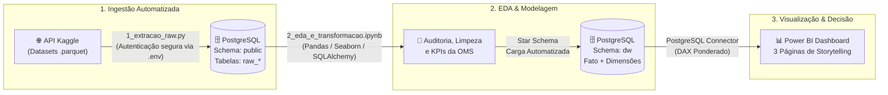

# O Abismo da Saúde: Infraestrutura vs. Economia no Brasil 🏥📊

[](https://www.python.org/)
[](https://www.postgresql.org/)
[](https://powerbi.microsoft.com/)
[](LICENSE)

Projeto de Business Intelligence ponta a ponta (End-to-End) desenvolvido para analisar a distribuição da infraestrutura de saúde pública (leitos e médicos pelo CNES/SUS) em relação à demografia (IBGE) e à economia municipal (PIB).

---

## 🎯 Pergunta de Negócio

> *"A distribuição de infraestrutura de saúde no Brasil é justa e proporcional à riqueza dos municípios, ou apenas reflete a desigualdade econômica e a concentração urbana?"*

Este projeto investiga se cidades com maior PIB per capita convertem sua riqueza em leitos e médicos SUS, ou se existe uma dependência estrutural em relação às capitais e polos regionais.

---

## 🏛️ Arquitetura do Pipeline de Dados

Substituímos ferramentas de arrastar-e-soltar (como Pentaho) por uma arquitetura moderna **Code-First** em Python e SQL:



---

## 📁 Estrutura do Repositório

```text
Projeto_BI_Saude/
│
├── .env.example                # Template de variáveis de ambiente seguras
├── .gitignore                  # Protege .env e dados brutos pesados
├── requirements.txt            # Dependências Python (pandas, pyarrow, sqlalchemy, etc.)
├── 00_setup_banco.sql          # Script de criação de banco e schema
├── 1_extracao_raw.py           # Pipeline de extração da API Kaggle e carga Staging/Raw
├── 2_eda_e_transformacao.ipynb # Notebook com EDA, gráficos e Star Schema (DW)
├── documentacao_powerbi.md     # Guia completo do Dashboard e fórmulas DAX
├── documentacao_arquitetura.md # Justificativas de modelagem dimensional e Kimball
├── roteiro_apresentacao_10min.md# Roteiro cronometrado para apresentação ao vivo
├── README.md                   # Documentação principal
│
├── dados_brutos/               # Arquivos Parquet baixados (ignorado no Git)
└── graficos/                   # Gráficos da EDA exportados automaticamente
```

---

## 🚀 Como Executar o Projeto

### 1. Pré-requisitos
* Python 3.10 ou superior instalado.
* PostgreSQL instalado localmente e em execução.
* Chave de API do Kaggle (gerada em sua conta: *Kaggle > Settings > API > Create New Token*).

### 2. Configuração do Ambiente
Clone este repositório e acesse a pasta do projeto:
```bash
git clone <url-do-seu-repositorio>
cd Projeto_BI_Saude
```

Instale as dependências:
```bash
pip install -r requirements.txt
```

### 3. Configuração de Credenciais
Copie o arquivo de exemplo `.env.example` para `.env`:
```bash
cp .env.example .env
```
Abra o arquivo `.env` e preencha com suas credenciais:
```ini
KAGGLE_USERNAME=seu_usuario_kaggle
KAGGLE_KEY=sua_api_key_kaggle
DB_USER=postgres
DB_PASS=sua_senha_postgresql
DB_HOST=localhost
DB_PORT=5432
DB_NAME=projeto_bi
```

### 4. Setup do Banco de Dados
No pgAdmin ou terminal `psql`:
1. Crie o banco `projeto_bi` (se ainda não existir).
2. Execute o arquivo `00_setup_banco.sql` conectado ao banco `projeto_bi` para criar o schema `dw`.

### 5. Execução do ETL (Fase 1 - Raw)
Execute o script de extração automática:
```bash
python 1_extracao_raw.py
```
*O script baixará seletivamente os 5 arquivos Parquet necessários e carregará as tabelas `raw_*` no PostgreSQL.*

### 6. Execução da EDA e Modelagem Dimensional (Fase 2 - DW)
Abra e execute o Jupyter Notebook:
```bash
jupyter notebook 2_eda_e_transformacao.ipynb
```
*O notebook realiza o tratamento de nulos, gráficos de outliers, cálculo dos KPIs da OMS e salva o Star Schema no schema `dw`.*

### 7. Construção do Dashboard (Fase 3 - Power BI)
Abra o Power BI Desktop e siga as orientações descritas em [`documentacao_powerbi.md`](documentacao_powerbi.md).

---

## 📊 Principais Indicadores (KPIs)

* **Leitos por Mil Habitantes:** $\frac{\text{Total de Leitos}}{\text{População}} \times 1000$ (Recomendação OMS: 3 a 5 leitos).
* **Médicos por Mil Habitantes:** $\frac{\text{Total de Médicos}}{\text{População}} \times 1000$.
* **Status OMS:** Categorização em *Crítico* (< 1), *Alerta* (1 a 3) e *Adequado* (> 3).
* **PIB per Capita:** Relação econômica por habitante para análise de correlação.

---

## 👥 Autores e Apresentação
Desenvolvido para o Bootcamp de Data Intelligence.  
Apresentação técnica de 10 minutos cobrindo: Arquitetura DW + Análise Exploratória (Python) + Storytelling Executivo (Power BI).
